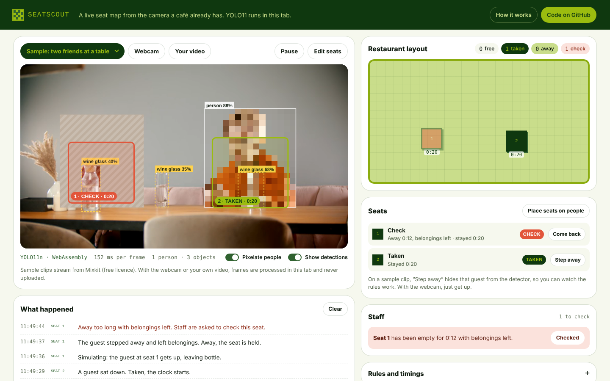

# SeatScout · AI Engine Prototype

Two prototypes from the SeatScout team live in this repository:

| | What | State | Try it |
| --- | --- | --- | --- |
| **SeatScout** (2024) | A live seat map from the camera a café already has | Runs in the browser | **[Open the live demo →](https://seatscout-social-app-team.github.io/AI-Engine-Prototype/seatscout/)** |
| **Cafe Finder engine** (2025) | The Python engine behind a personalised café search | Keyword step runs, the rest is designed | `python -m llm_modules.keyword_extraction "…"` |

The Cafe Finder app itself is in [donganh1409/perfect-cafe-finder](https://github.com/donganh1409/perfect-cafe-finder).

---

## SeatScout: a live seat map



A camera frame goes through five steps:

1. **Video.** A café's CCTV. In the demo: a sample clip, your webcam, or a video file.
2. **Detect.** YOLO11n finds people, and the things guests leave on a table or a chair (bags, laptops, cups, bottles, phones, books). It runs in the browser with ONNX Runtime Web, on WebGPU when available and WebAssembly otherwise.
3. **Assign.** Each seat is a zone on the image. A person counts for a seat when they cover a quarter of its zone. Belongings count while they were seen in the last 4 seconds, because small objects flicker in and out of detection.
4. **Decide.** A small state machine per seat ([`docs/seatscout/seats.js`](docs/seatscout/seats.js)):

   | From | To | When |
   | --- | --- | --- |
   | Free | Taken | a person stays on the seat for 1 s; the clock starts |
   | Taken | Away | nobody on the seat for 1.5 s; the clock keeps running |
   | Away | Taken | the person is back; same clock |
   | Away | Free | nothing left behind, away longer than the grace period; the clock resets |
   | Away | Check | belongings left, away longer than the limit; staff are asked to look |
   | Check | Free | staff mark the seat checked |

5. **Show.** The layout, the seat list and the staff alerts update live.

The timings are in seconds in the demo so the rules are visible, and they can be changed in "Rules and timings". In a café they would be minutes.

On a recorded clip nobody gets up, so each seat has a **Step away** button: it hides that guest from the detector (the frame fed to YOLO is masked) while keeping what they left on the table, and the rules react to what the detector really sees. With the webcam, just get up.

**Privacy.** Frames are processed inside the browser tab and never uploaded. People are pixelated on screen by default. The layout needs seat states, not faces.

### Run it locally

```bash
cd docs
python -m http.server 8000
# open http://localhost:8000/seatscout/
```

The model is `docs/seatscout/model/yolo11n.onnx` (10.7 MB), exported from Ultralytics YOLO11n. See [`docs/seatscout/MODEL-LICENSE.md`](docs/seatscout/MODEL-LICENSE.md) for how it was exported and its licence (AGPL-3.0).

---

## Cafe Finder engine

The engine turns a sentence like *"I'm feeling a bit lonely, just want a quiet, hidden cafe with old books and some acoustic music around District 1"* into a ranked, explained list of cafés. The pipeline is described in [`workflow.md`](workflow.md) and [`architecture.md`](architecture.md):

| Step | Module | State |
| --- | --- | --- |
| 1. Keywords from the sentence (LLM) | `llm_modules/keyword_extraction.py` | **Runs**, with tests |
| 2. User insights: taste from past visits | `user_analysis/` | Designed |
| 3. Place insights: distance, time, weather, social | `place_insights/` | Designed |
| 4. Aggregate into one JSON object | `aggregation/aggregate.py` | Designed |
| 5. Optional vector search (Qdrant or FAISS) | `vector_search/` | Designed |
| 6. Rank and explain (LLM) | `llm_modules/recommendation_engine.py` | Designed |

### Run the keyword step

```bash
pip install -r requirements.txt
export GROQ_API_KEY=...        # https://console.groq.com
python -m llm_modules.keyword_extraction "a quiet vegan cafe in District 1 with strong wifi"
# prints a list, e.g. ['quiet', 'vegan cafe', 'District 1', 'strong wifi', 'work remotely']
pytest -q                      # uses a fake client: no key, no network
```

The first version ran Mistral locally through Ollama. It then moved to Groq's OpenAI-compatible API, so the same client code works with any compatible provider. Groq has since retired `llama3-8b-8192` and `llama-3.1-8b-instant`, so the default is now `openai/gpt-oss-20b`; set `GROQ_MODEL` to change it. The reply is parsed as a JSON array, then a Python list, then one keyword per line, because models do not always follow the format.

---

## Team

- **Dong Anh Nguyen**: founder. Product and UX; designed the computer-vision pipeline and the seat rules for SeatScout, and the personalisation for Cafe Finder; wrote the keyword step.
- **Srihari Murali** (AI Engineer, Deloitte): built the 2024 SeatScout detector; laid out the engine's architecture.
